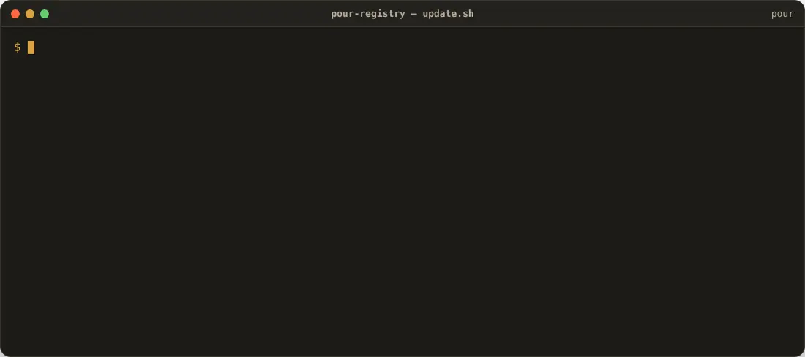
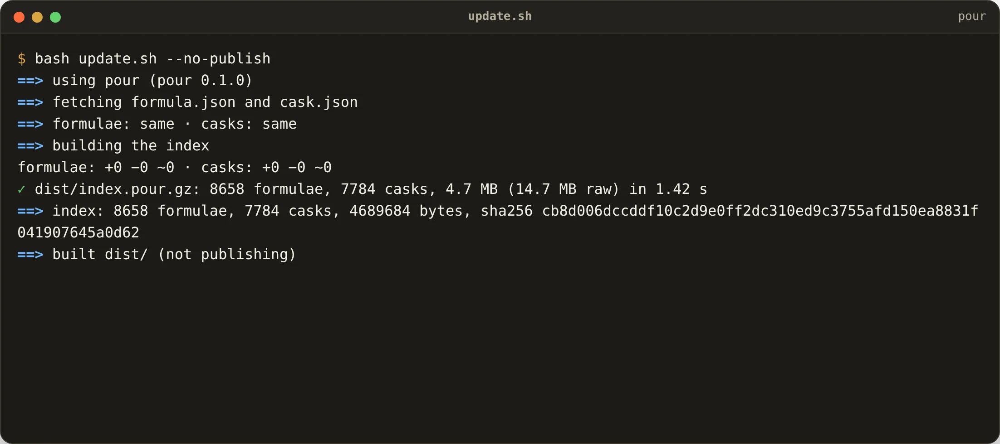
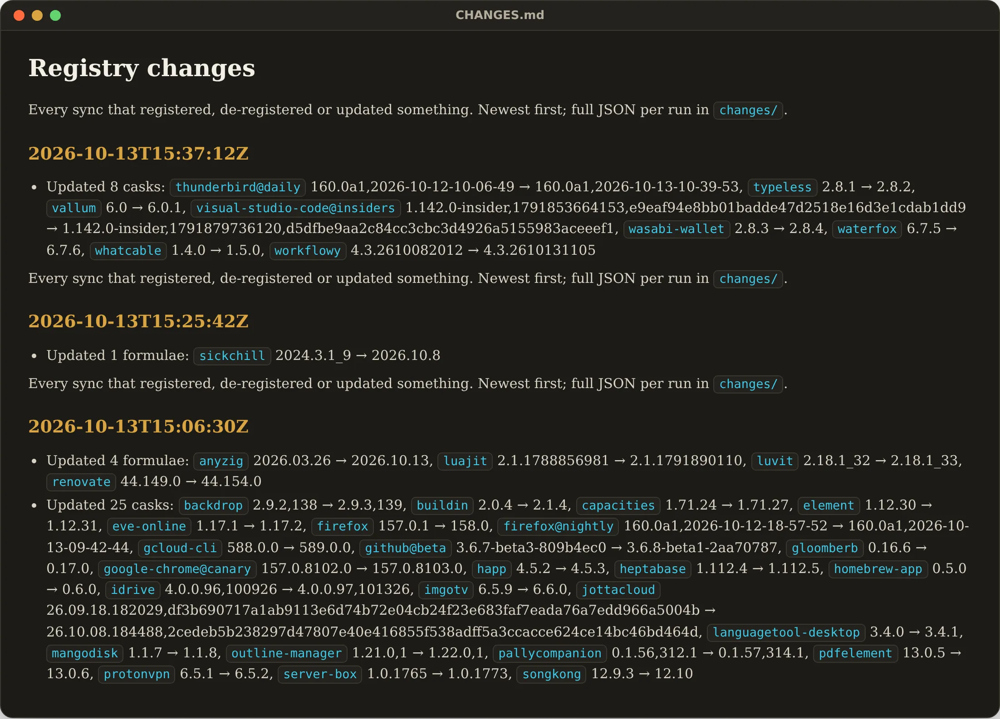

<p align="center">
  <picture>
    <source media="(prefers-color-scheme: dark)" srcset="docs/pour-dark.svg">
    
  </picture>
</p>

<h1 align="center">pour-registry</h1>

<p align="center"><strong>Every Homebrew formula and cask, registered for <a href="https://github.com/JKS-sys/pour-13-Oct-2026">Pour</a> and kept in sync automatically.</strong><br>
Re-indexed every four hours · additions and removals logged · one 4.7 MB file</p>

<!-- stats:start -->
| | |
|---|---|
| Formulae registered | **8,684** |
| Casks registered | **7,816** |
| Last sync | `2026-10-29T21:12:32Z` |
| Index size | 4.7 MB (gzip) |
| SHA-256 | `a2cd31b389ef2d32…` |
<!-- stats:end -->


> ⭐ **If Pour saves you time, star this repository** — stars are how other people find it.

## What this is

Pour does not read Ruby formulae. It reads one binary index — `index.pour.gz` — that this repository builds from [Homebrew's public JSON API](https://formulae.brew.sh/api) and publishes to:

- the rolling GitHub release [`latest`](https://github.com/JKS-sys/pour-registry-13-Oct-2026/releases/tag/latest) (`index.pour.gz`, `index.json`, `search.json`, `changes.json`)
- Cloudflare R2, served at [`ipconfig.co.network/pour/registry/index.pour.gz`](https://ipconfig.co.network/pour/registry/index.pour.gz) with ETags, so `pour update` is one conditional request.

Every run diffs the new index against the last one. **New packages are registered, vanished ones are de-registered**, version bumps are recorded — in [`CHANGES.md`](CHANGES.md) and as JSON under [`changes/`](changes/).

## See it move

A real sync run: fetch with ETags, build the index in a second, diff, write the log, publish.



[▶ Watch with sound (MP4)](docs/demo-sync.mp4)

<table>
<tr>
<td><br><sub>`update.sh` — ETag-cached fetch, a 1-second build, the diff and the publish steps.</sub></td>
<td><br><sub>`CHANGES.md` — what each sync registered, de-registered and updated.</sub></td>
</tr>
</table>

## update.sh — the one script

```sh
bash update.sh              # fetch → build → diff → publish (release + R2 + log + README)
bash update.sh --no-publish # build and diff only, into dist/
```

Steps, in order:

1. find a `pour` binary (`POUR_BIN`, `../pour/target/release/pour`, or the newest release)
2. `curl` `formula.json` and `cask.json` with `If-None-Match`, so an unchanged API costs two requests
3. `pour registry build` → `dist/index.pour.gz` (+ `search.json` for the website), diffed against the previous index
4. `scripts/changes.py` → `changes/<stamp>.json` and the top of `CHANGES.md`; `scripts/readme.py` refreshes the numbers above
5. publish: GitHub release `latest` (assets replaced), R2 (`wrangler r2 object put`, retried), commit the log

[`.github/workflows/sync.yml`](.github/workflows/sync.yml) runs it every four hours and on demand. Secrets: `CLOUDFLARE_API_TOKEN`, `CLOUDFLARE_ACCOUNT_ID` (R2 is optional — GitHub Releases always works).

## The index format

`index.pour` is a memory-mapped file: a sorted name table, `postcard`-encoded records and a lower-cased search text per package, for formulae and casks separately, plus an alias table (aliases and old names resolve in the same binary search). `pour info jq` opens the file, binary-searches 8,658 names and decodes one record — about two milliseconds, most of it process start-up. The format is documented in [`pour-core/src/index.rs`](https://github.com/JKS-sys/pour-13-Oct-2026/blob/main/crates/pour-core/src/index.rs); the schema version lives in the file magic, so an old index is refetched rather than misread.

`index.json` (metadata), `search.json` (name, kind, description, version, homepage — for the website's search) and `changes.json` (the last diff) sit beside it.

<!-- licence -->
## Licence

Copyright © 2026 **Jagadeesh Kumar S**. All rights reserved. The scripts and the index format are source-available under the [Pour licence](https://github.com/JKS-sys/pour-13-Oct-2026/blob/main/LICENSE). Third-party notices live in the main repository's `THIRD-PARTY-NOTICES.txt`.
<!-- /licence -->

---

> **If Pour helps you, please ⭐ star this repository — it helps other people find it.**
